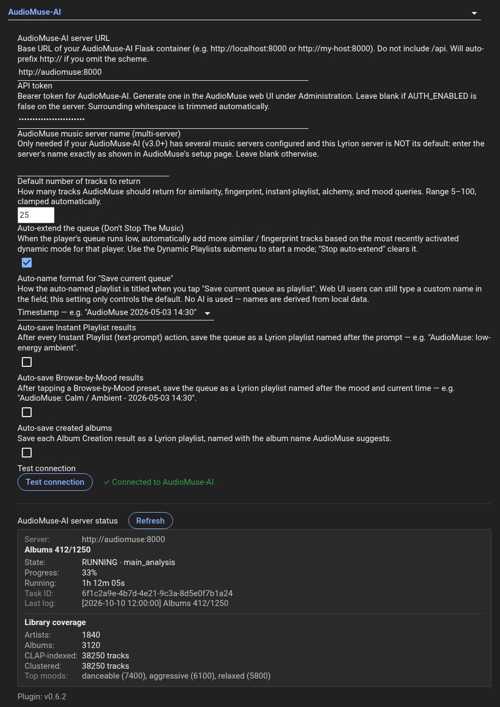

# Settings

**Settings → Plugins → AudioMuse-AI.**

<p align="center"></p>

| Setting | What it does |
|---|---|
| **Server URL** | Where AudioMuse-AI is running. `http://` is auto-prefixed; trailing slashes are stripped. |
| **API token** | Bearer token from the AudioMuse-AI web UI → Administration. Whitespace trimmed; CR/LF rejected. |
| **AudioMuse music server name** | Only for AudioMuse-AI v3 setups with **several** music servers where this Lyrion is *not* AudioMuse's default server: the server's name as shown on AudioMuse's setup page. Every request then targets that server, so the track ids AudioMuse returns are Lyrion's. Leave blank otherwise. |
| **Default count** | How many tracks per playlist (clamped 5–100). Also the length AI Chat Playlist asks for. |
| **Auto-extend the queue (DSTM)** | Lets the plugin's own Dynamic Playlists modes refill the queue when it drops to ≤ 3 remaining. (Auto-enabled the first time you start a Dynamic Playlists mode.) See also [Don't Stop The Music](#dont-stop-the-music). |
| **Auto-name format** | How "Save current queue" names playlists when you don't type a name. See [below](#auto-name-strategies). |
| **Auto-save Instant Playlist results** | After every Instant Playlist, save the queue as `AudioMuse: <prompt>`. |
| **Auto-save Browse-by-Mood results** | After tapping a Mood preset, Sonic mood or Lyric theme, save as `AudioMuse: <mood> - <timestamp>`. |
| **Auto-save created albums** | After Album Creation, save the queue as `AudioMuse album: <suggested name>`. |
| **Test connection** | Probes the server; result is polled in-place via JSON-RPC. With a server name set, also confirms AudioMuse has a music server by that name. |

The settings page also shows a live **Server Status panel** — current task (status message, state, progress %, running time, last log line) plus a **Library coverage** section (artists, albums, CLAP-indexed tracks, clustered tracks, top moods). It auto-refreshes every 10 s while a task is running.

## Mix filters

Applied to every mix the plugin builds — similar tracks, moods, instant playlists, Don't Stop The Music and the rest — but not to Album Creation or Find Path, which keep their own running order. The ideas come from Craig Drummond's [AudioMuse Mixer](https://github.com/CDrummond/lms-audiomuse-mixer).

| Setting | Default | What it does |
|---|---|---|
| **Don't repeat an artist within** | 10 | Tracks before the same artist can come round again. Relaxed automatically if there aren't enough other candidates. 0 = off. |
| **Don't repeat an album within** | 20 | Same for albums (Various Artists albums exempt). |
| **Minimum / maximum track length** | 0 / 0 | In seconds — skip interludes, or anything over e.g. 600 s. 0 = no limit. |
| **Christmas music only in December** | on | Leaves out Christmas / Xmas genre tracks the rest of the year. |
| **Never include these artists / albums** | — | One per line; albums as `Artist//Album` or just `Album`. |
| **Stay within the seed's genre group** + **Genre groups** | off | Groups like `Metal; Hard Rock; Heavy Metal`, one per line. A mix only uses tracks from the seed track's group(s); if the seed isn't grouped, grouped tracks are left out. Options: treat ungrouped genres as their own group, and require *all* of a track's genres to be in the group. |
| **Shuffle mixes** | on | Picks at random from the best matches (up to twice as many as needed), so the same seed gives a different mix each time. |
| **Stricter similarity** | off | Asks AudioMuse to also match mood and stay within its similarity radius. |
| **Don't replay a song within** | 1000 | Recently played songs per player kept out of auto-extend and "add similar". |

## Don't Stop The Music

| Setting | Default | What it does |
|---|---|---|
| **Tracks added each time** | 10 | How many tracks each top-up adds. |
| **Seed tracks** | 1 | How many tracks from the end of the queue each top-up is based on (several are blended). |
| **Always use the last tracks as seeds** | off | On: exactly the last N. Off: picked at random from a few more recent tracks, for variety. |
| **Fall back to Last.fm mixer** | on | If AudioMuse finds nothing and the Last.fm Mixer plugin is installed, use it rather than Lyrion's random mix. |

## Interface

**Menus → Don't Stop The Music only** hides the AudioMuse-AI menu under My Music, the context-menu entries and the web page, leaving just the Don't Stop The Music choices (Player Settings → Audio) and this settings page. Switch back to **Full** any time; no restart needed.

## Auto-name strategies

How **Save current queue as playlist** titles a playlist when no name is typed:

| Strategy | Example |
|---|---|
| **Timestamp** (default) | `AudioMuse 2026-05-03 14:30` |
| **First track** | `AudioMuse: 1933 - Frank Turner` |
| **Artist mix** | `AudioMuse: Frank Turner, Phish, U2 (24t)` |
| **Mood-tagged** | `AudioMuse: Calm / Ambient - 2026-05-03 14:30` |
| **Last Instant prompt** | `AudioMuse: low-energy late-night ambient` |

> **No AI is used for naming.** AudioMuse-AI's CLAP search is an audio-embedding model, not an LLM. Names are derived from local data — timestamp, queue contents, your typed prompt, or the mood label.

## Don't Stop The Music providers

The plugin registers five native **Don't Stop The Music** providers, so AudioMuse-AI appears in the per-player dropdown alongside MusicIP / SugarCube / LastMix:

- **AudioMuse-AI: Similar to recent tracks** — extends the queue with tracks similar to what was just queued.
- **AudioMuse-AI: Lyrics + sound mix (SemGrove)** — the same, on the merged lyrics + audio index.
- **AudioMuse-AI: Hyperbolic map mix** — close neighbours on AudioMuse's hyperbolic map.
- **AudioMuse-AI: Mix by recent album (broader)** — blends the whole album of the last queued track.
- **AudioMuse-AI: Sonic fingerprint** — extends from your listening history's sonic fingerprint.

All five skip anything already queued or recently played on that player, and other copies of the same song — see [No repeats](USAGE.md#no-repeats).

Set it under **Player Settings → Audio → Don't Stop The Music**. It's per-player, and when active it takes over auto-extend for that player (the plugin's own Dynamic Playlists auto-extend stands down to avoid double-filling).

This is independent of the **Auto-extend the queue** checkbox above, which only governs the plugin's own menu-based Dynamic Playlists modes.

## Per-player default count override

The default count is server-global, but each player can override it via Lyrion's standard pref CLI (no dedicated UI):

```bash
# 'Living Room' player uses 50 instead of the global default
curl -X POST http://lyrion:9000/jsonrpc.js -H "Content-Type: application/json" \
  -d '{"id":1,"method":"slim.request","params":["bb:bb:55:90:9c:db",
       ["pref","plugin.audiomuseai:default_count","50"]]}'
```

Clear it (revert to the global default) by setting the value to an empty string.
